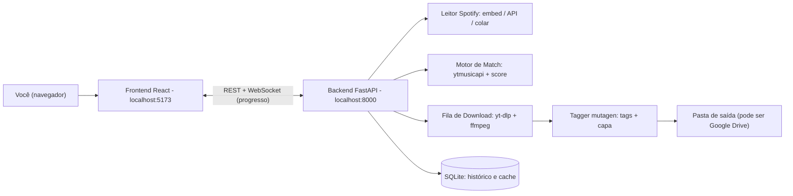
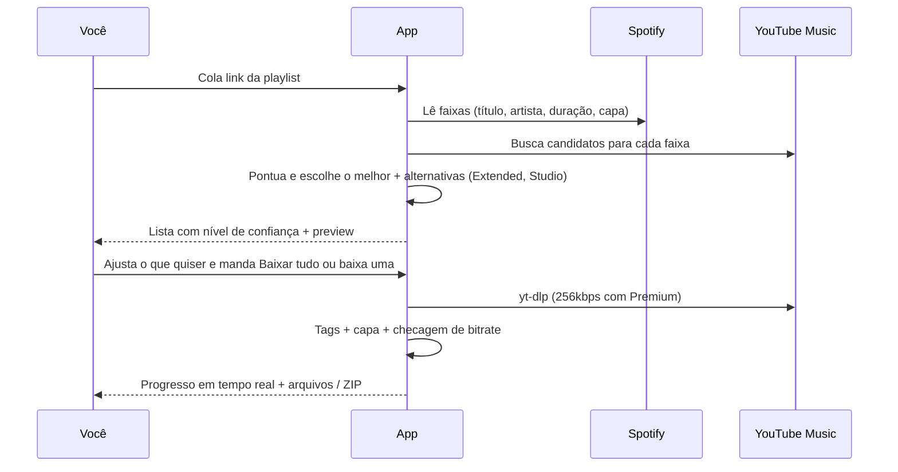

# 🎧 DJ Downloader: proposta de arquitetura

App local, só para você: cole um link (playlist do Spotify, faixa do Spotify, link do YouTube/YT Music ou só "artista - música") → o app acha a versão certa no YouTube Music → baixa com a melhor qualidade possível e já com as tags (título, artista, capa).

---

## 1. Como o y2meta funciona (e por que não vamos depender dele)

Analisei o fluxo do y2meta e de sites parecidos:

1. Você cola o link → o front manda o ID do vídeo para o backend deles.
2. O backend usa um extrator do YouTube (do tipo **yt-dlp**) para pegar a URL do stream de áudio.
3. Ele converte com **ffmpeg** para MP3 e te entrega o arquivo.

> [!WARNING]
> **O "MP3 320kbps" desses sites é falso.** O YouTube entrega o áudio no máximo em **Opus ~160kbps** ou **AAC 128kbps** (para conta gratuita). Converter isso para "320kbps" só aumenta o arquivo: a qualidade continua a do original. Além disso, esses sites têm anúncios, limites e quebram com frequência.

**Conclusão:** vamos usar as mesmas peças (yt-dlp + ffmpeg) direto na sua máquina, sem intermediário, e com controle real da qualidade.

---

## 2. A questão da qualidade (regra do mínimo de 192kbps)

| Fonte no YouTube Music | Formato | Bitrate real | Atende ≥192? |
|---|---|---|---|
| Conta gratuita | Opus (itag 251) | ~130–160 kbps | ❌ |
| Conta gratuita | AAC (itag 140) | 128 kbps | ❌ |
| **YouTube Music Premium** (via cookies do seu navegador) | **AAC (itag 141)** | **256 kbps** | ✅ |

> [!IMPORTANT]
> Para cumprir a regra de **192kbps reais**, o caminho é usar sua conta **YouTube Music Premium**. O app lê os cookies do seu navegador (com `yt-dlp --cookies-from-browser chrome`) e baixa o stream de 256kbps.
> O app **mede o bitrate de verdade** de cada arquivo e marca com 🔴 tudo que ficar abaixo de 192, em vez de esconder isso com um upscale.

**Formato de saída (você escolhe nas configurações):**
- **M4A/AAC 256 (recomendado):** sem recompressão, qualidade 100% preservada. Rekordbox, Serato, Traktor e VirtualDJ leem normalmente.
- **MP3 320 CBR:** para máxima compatibilidade (CDJs antigos/pendrive). Tem uma recompressão leve a partir do AAC 256.

---

## 3. A questão do Spotify (ponto de atenção)

> [!CAUTION]
> Em 2025/2026 a API oficial do Spotify ficou bem restrita: **ela só devolve as faixas de playlists que pertencem ao usuário logado (ou em que ele colabora)**. Playlists de noivos/terceiros não aparecem via API.

Por isso, a leitura da playlist terá **3 camadas de fallback**:

1. **Página pública/embed do Spotify** (`open.spotify.com/embed/playlist/...`): lê o JSON que a própria página carrega (título, artistas, duração, capa). Não precisa de login. É o método principal.
2. **API oficial com seu login (OAuth PKCE)**: para playlists suas ou colaborativas.
3. **Colar a lista:** no Spotify desktop, `Cmd+A` → `Cmd+C` nas músicas copia todos os links das faixas. Você cola no app e ele resolve uma por uma. Funciona sempre.

---

## 4. Visão geral



### Fluxo de uma playlist



---

## 5. Motor de match (a parte mais importante)

Para cada faixa do Spotify, o app busca no **YouTube Music com filtro "songs"**, que prioriza os uploads oficiais ("Artista - Topic", áudio de estúdio, sem clipe e sem intro). Cada candidato recebe uma nota:

| Critério | Peso |
|---|---|
| Similaridade do título (fuzzy, sem "feat.", "Remastered" etc.) | alto |
| Artista bate (incluindo feats) | alto |
| **Diferença de duração** (±3s = ótimo, >15s = suspeito) | alto |
| É "song" oficial/Topic (e não vídeo de usuário) | médio |
| Penalidades: `live`, `ao vivo`, `cover`, `karaoke`, `8D`, `sped up`, `slowed`, `remix` (quando o original não é) | forte |

**Resultado por faixa:**
- 🟢 **Alta confiança:** baixa direto.
- 🟡 **Média:** mostra o top 3 com um player de preview para você confirmar.
- 🔴 **Baixa:** pede revisão manual (dá para colar um link do YT na hora).

**Sugestões para DJ (aparecem como "alternativas"):**
- 🎛️ **Extended / Extended Mix / Club Mix**, quando existir.
- 🎙️ **Versão de estúdio**, quando a da playlist for ao vivo.
- ✂️ Opcional: **Radio Edit / Clean**.

---

## 6. Stack

| Camada | Tecnologia | Por quê |
|---|---|---|
| Backend | **Python 3.12 + FastAPI** | yt-dlp, ytmusicapi e mutagen são Python |
| Download | **yt-dlp + ffmpeg** | o mesmo "motor" que os sites usam, atualizado com frequência |
| Busca | **ytmusicapi** | busca nativa do YT Music (songs, albums, metadados) |
| Tags | **mutagen** | título, artista, álbum, ano, capa em alta resolução |
| Persistência | **SQLite** | histórico, cache de matches, evita baixar a mesma música duas vezes |
| Frontend | **React + Vite + TypeScript + Tailwind + shadcn/ui + Framer Motion** | UI moderna, dark mode, animações suaves |
| Tempo real | **WebSocket** | barra de progresso por faixa |
| Execução | um comando: `./start.sh` | sobe tudo e abre o navegador |

**Armazenamento / Google Drive:** a opção mais simples é apontar a pasta de saída para a pasta do **Google Drive para Desktop** (ex.: `~/Google Drive/Meu Drive/DJ/Casamento X/`). Assim tudo sincroniza sozinho, sem precisar de API. A integração via API do Drive pode vir depois, se você quiser.

---

## 7. Telas (UI)

1. **Home:** um campo grande "Cole um link ou digite uma música" que detecta sozinho se é playlist do Spotify, faixa, link do YT ou texto.
2. **Playlist/Projeto:** capa e nome, tabela das faixas (capa, título, artista, duração, confiança, versão escolhida, alternativas), filtros (🟡/🔴 pendentes) e os botões **Baixar tudo** e **Baixar ZIP**.
3. **Fila de downloads:** progresso em tempo real, bitrate final e botão de tentar de novo.
4. **Biblioteca/Histórico:** tudo que já foi baixado, organizado por evento (ex.: "Casamento Ana & João").
5. **Configurações:** formato (M4A/MP3), pasta de saída, navegador de onde vêm os cookies, padrão de nome do arquivo (`Artista - Título (Extended Mix).m4a`).

Estilo: dark mode, glassmorphism discreto, tipografia forte e um toque visual de "deck de DJ" (waveform no preview).

---

## 8. Estrutura de pastas

```
dj-downloader/
├── backend/
│   ├── app/
│   │   ├── main.py            # FastAPI + rotas + WebSocket
│   │   ├── sources/spotify.py # embed / API / colar
│   │   ├── matching/          # busca YTM + scoring + alternativas
│   │   ├── download/          # fila, yt-dlp, ffmpeg, verificação de bitrate
│   │   ├── tagging.py         # mutagen
│   │   └── db.py              # SQLite
│   └── pyproject.toml
├── frontend/                  # React + Vite
└── start.sh
```

---

## 9. Riscos e observações

- **Spotify pode mudar a página embed:** por isso existem os fallbacks (API e colar a lista).
- **O YouTube muda o player com frequência:** o app atualiza o yt-dlp automaticamente ao iniciar.
- **Uso legal:** baixar do YouTube vai contra os termos de uso dele. Para tocar em evento, o ideal é ter as faixas licenciadas (pool de DJ, Beatport, etc.). A ferramenta é para seu uso pessoal.

---

## 10. Plano de construção (por fases)

1. **MVP:** música solta (link do YT ou texto) → download com tags. Valida a qualidade com seus cookies Premium.
2. **Playlist Spotify:** leitura + motor de match + tela de revisão.
3. **Fila + "Baixar tudo"/ZIP** + progresso em tempo real.
4. **Sugestões Extended/Studio**, histórico e acabamento visual.
